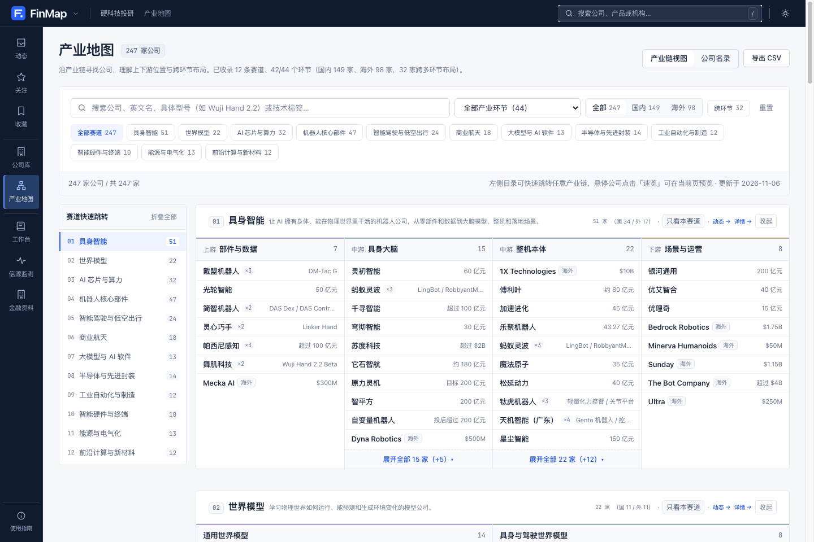
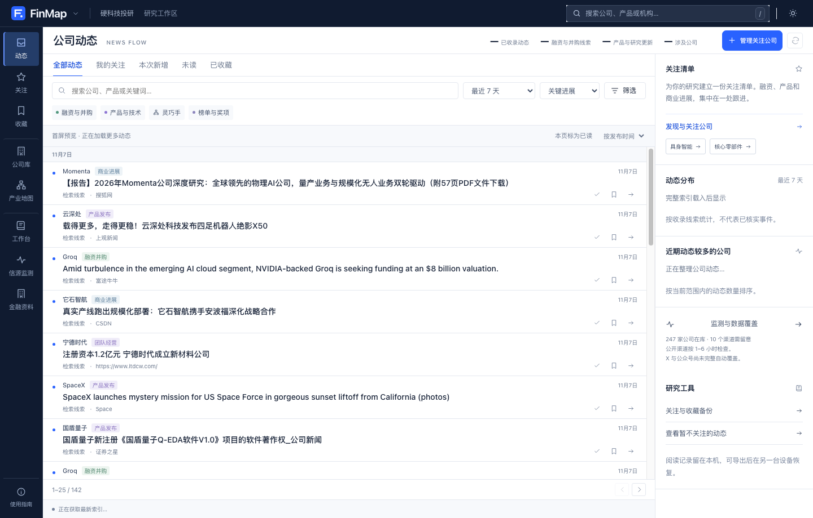
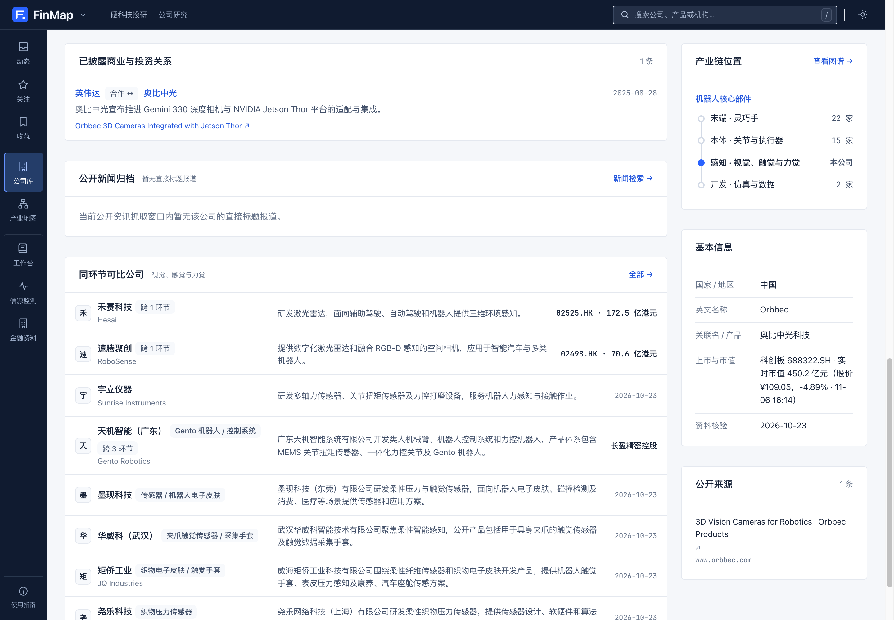

<div align="center">

# FinMap · 硬科技产业链与金融机构研究终端

**用结构化代码与公开证据，绘出 247 家全球硬科技公司产业链位置、实时市值与 4,959 家持牌金融机构股权谱系。**

[](https://map.finhot.fun)
[](https://finhot.fun)
[-1d4ed8?style=flat-square)](https://map.finhot.fun/ventures/)
[](https://map.finhot.fun/companies/)
[](https://map.finhot.fun/financial/)
[](package.json)

<p align="center">
  <a href="https://map.finhot.fun"><b>立即访问线上工作台 (map.finhot.fun) ↗</b></a> ·
  <a href="https://map.finhot.fun/ventures/">硬科技产业图谱</a> ·
  <a href="https://map.finhot.fun/companies/">公司库与实时市值</a> ·
  <a href="https://map.finhot.fun/financial/">持牌金融机构谱系</a> ·
  <a href="#可直接复用的开源数据集">开源数据集</a> ·
  <a href="#本地运行与构建校验">本地运行</a>
</p>

</div>

<p align="center">
  <picture>
    <source media="(prefers-color-scheme: dark)" srcset="docs/assets/hero-ventures-dark.png">
    
  </picture>
</p>

<table width="100%">
  <tr>
    <td width="50%" align="center">
      <br>
      <sub><b>公司动态工作台</b>：396 个一手信源持续跟踪融资、产品发布与商业落地</sub>
    </td>
    <td width="50%" align="center">
      <br>
      <sub><b>公司档案与实时市值</b>：A 股 / 港股 / 美股 60 家上市硬科技公司盘中市值自动更新</sub>
    </td>
  </tr>
</table>

---

## 为什么做 FinMap

做一级市场硬科技尽调（具身智能、人形机器人、世界模型、AI 算力、商业航天）或金融机构穿透研究时，最常遇到三个痛点：

1. **传统的“行研产业图谱”只是一张贴满 Logo 的静态图片**：既看不出一家公司具体卡在哪个上下游环节、做哪款核心型号，也没法点开核验它的公开估值、官网出处与供货关系。
2. **一级市场估值与二级市场市值脱节**：很多数据库连已上市的龙头（如奥比中光、绿的谐波、速腾聚创、禾赛、汇川技术）还写着“未披露估值”或几年前的静态数字。
3. **中国持牌金融机构名单是平铺的四千多行 PDF**：能查到名单，却查不到“招商银行那 26.32% 股权是谁持的、穿过了几条集团通道”，也分不清谁有央行金控牌照、谁只是挂名关联。

**FinMap 把这些分散的信息做成了可检索、可交叉跳转、每一条结论都带公开出处的研究终端（并与 [FinHot 金融与 AI 每日信息台](https://finhot.fun) 共享同一套终端交互体系）：**

- **12 条硬科技赛道 × 44 个产业链环节 × 247 家国内外代表公司**：支持左侧赛道目录一键跳转、跨多环节布局标记（`×2` / `×3`）、当前页抽屉速览与 CSV 导出。
- **核心部件代表型号参数横向并排对比**：在「04 机器人核心部件」赛道内嵌五指灵巧手等核心部件的参数矩阵（主动自由度、直驱/腱绳/连杆传动路线、裸手与含腕重量口径、触觉感知与仿真 SDK），严格注明官方技术手册口径，拒绝把不同口径数字直接硬排。
- **247 家全量资本状态覆盖 + 60 家上市公司实时市值引擎**：一级市场公司标注最新投后估值与核验时点；60 家 A 股 / 港股 / 美股上市公司通过边缘函数 `/api/quotes` 实时拉取总市值、股价与涨跌幅。
- **396 个一手渠道与新闻源持续监测**：区分「官方渠道发布」「已核验历史融资/产品事件」与「公开媒体检索线索」，支持本机关注、未读追踪与 JSON 备份恢复。
- **4,959 家持牌金融机构名册 + 四大集团股权穿透谱系**：对齐人行编码规范与国家金融监管总局官方名单，银行业（4,070 家）与保险业（238 家）逐类对账 0 缺漏。

---

## 可直接复用的开源数据集

如果你在做行业研究、量化映射或构建投研 Agent，仓库里的 YAML / JSON 数据可以直接作为结构化知识库使用：

| 数据路径 | 内容与覆盖范围 | 核心字段 |
|---|---|---|
| [`data/ventures/*.yaml`](data/ventures/) | **12 条硬科技赛道与 247 家公司档案**（具身智能 51、机器人核心部件 47、AI 芯片与算力 32、智能驾驶与低空 24、世界模型 22、商业航天 18、半导体 14 等） | `id`, `name`, `en`, `track`, `segment`, `memberships`, `valuation`, `events`, `relations`, `sources` |
| [`data/topics/dexterity.json`](data/topics/dexterity.json) | **机器人灵巧操作与灵巧手型号参数库**（6 类技术栈角色 + 代表型号工程参数） | `actuation`, `dof`, `weight`, `sensing`, `software`, `evidence` |
| [`data/monitor/registry.json`](data/monitor/registry.json) | **247 家硬科技公司官方监测源注册表**（396 个一手官网、Blog、GitHub Releases 与检索源） | `companyId`, `sources[]`, `cadenceHours` |
| [`data/taxonomy.yaml`](data/taxonomy.yaml) | **中国持牌金融机构 8 大分类、50+ 牌照序列骨架**（对齐银发〔2015〕309 号） | `categories`, `types`, `regulator`, `outOfScope` |
| [`data/groups/*.yaml`](data/groups/) | **中信、中国平安、招商局、光大四大集团股权谱系树**（含穿透持股比例、时点与多通道合计说明） | `parent`, `stake`, `stake_asof`, `stake_basis`, `held_via`, `relation` |
| [`data/registry/*.yaml`](data/registry/) | **4,959 家持牌金融机构法人全量名册**（含 4,274 个已核实机构编码与 1,183 个核实官网） | `license_code`, `regulator`, `region`, `listed`, `tier`, `status` |

---

## 本地运行与构建校验

环境要求：**Node.js >= 24**。

```bash
git clone https://github.com/Jrdgr-FE/finmap-public.git
cd finmap-public
npm install

# 启动本地开发服务器 (http://localhost:4321)
npm run dev

# 运行硬科技图谱、监测引擎与工作台单元测试
npm run test:ventures
npm run test:ui

# 运行全量数据完整性校验（断链、悬空节点、环形股权、估值与许可证格式自检）
npm run validate

# 生成金融机构覆盖报告并与监管总局官方 PDF 基线逐类对账
npm run report

# 构建生产静态站点与边缘函数 (输出至 dist/)
npm run build
```

---

## 模块一：硬科技产业链图谱与公司监测 (`/`, `/ventures/`, `/companies/`)

### 1. 十二条核心硬科技赛道

| 编号 | 赛道 | 产业链环节划分 |
|---|---|---|
| `01` | **具身智能** | 上游·部件与数据 → 中游·具身大脑 → 中游·整机本体 → 下游·场景与运营 |
| `02` | **世界模型** | 通用世界模型 → 具身与驾驶世界模型 |
| `03` | **AI 芯片与算力** | 上游·互连与光通信 → 芯片·训练与通用加速 → 芯片·推理与端侧芯片 → 下游·智算云与集群运营 |
| `04` | **机器人核心部件** | 末端·灵巧手 → 本体·关节与执行器 → 感知·视觉、触觉与力觉 → 开发·仿真与数据 |
| `05` | **智能驾驶与低空出行** | 智驾·自动驾驶方案 → 干线·Robotaxi 与干线物流 → 末端·无人配送与特种作业 → 低空·eVTOL 与飞行器 |
| `06` | **商业航天** | 制造·商业火箭 → 制造·卫星制造与载荷 → 运营·星座运营与航天服务 → 前沿·太空算力与轨道基建 |
| `07` | **大模型与 AI 软件** | 基础与多模态模型 → 垂类模型与智能体 → 开发工具与 AI 基础设施 |
| `08` | **半导体与先进封装** | 上游·EDA 与 IP → 设备·前道与量检测设备 → 设备·先进封装与微纳制造 → 制造·晶圆代工与功率芯片 |
| `09` | **工业自动化与制造** | 核心控制器与伺服系统 → 工业与协作机器人 → 机器视觉与智能产线 |
| `10` | **智能硬件与终端** | AR / AI 眼镜与穿戴设备 → 消费级机器人与 3D 打印 → 医疗与脑机接口设备 |
| `11` | **能源与电气化** | 前沿·可控核聚变 → 储能·新型电池与长时储能 → 电网·电力电子与充换电 |
| `12` | **前沿计算与新材料** | 量子计算与光计算 → 生物计算与先进材料 |

### 2. 资本状态与实时市值引擎 (`/api/quotes`)

- **一级市场公司**：统一展示最新已核实估值（如 `投后 200 亿元`、`约 $10B`）或最新融资轮次（如 `A 轮`、`天使轮`）；高等院校与国立科研院所孵化主体明确标注 `科研机构孵化`。
- **二级市场上市公司（60 家）**：由 Cloudflare Pages Function [`functions/api/quotes.js`](functions/api/quotes.js) 批量聚合 A 股（科创板/创业板/主板）、港股与美股实时行情（边缘缓存 120 秒），前端进入页面及每 2 分钟自动无感刷新最新市值、股价与涨跌幅。

---

## 模块二：中国持牌金融机构图谱 (`/financial/`, `/orgs/`, `/groups/`, `/roster/`)

### 1. 三层结构 + 两档深度

```text
监管与基础设施层     42 家   定规则、发牌照、办登记清算（央行、金监总局、证监会、交易所、清算所等）
集团谱系层           90 家   4 个综合金融集团（中信、中国平安、招商局、光大），带穿透股权边
全牌照名录层      4,700+ 家  按 50+ 牌照序列收全的持牌法人机构名册
```

- **`tier: detailed`（1,314 家）**：逐一核实官网、业务、股权比例与公开出处，生成完整机构档案页（`/orgs/`）。
- **`tier: mass`（3,645 家）**：从监管总局官方名单批量导入并对齐机构编码与属地（如农村商业银行 1,505 家、村镇银行 1,440 家），在 `/roster/` 独立展示，不与深度核实档案混淆。

### 2. 构建期质量闸门（`npm run validate` & `npm run report`）

| 校验规则 | 解决的实际工程问题 |
|---|---|
| `category` / `type` 严格对齐 taxonomy | 防止「银行业」下误挂「信托公司」 |
| 全局唯一 ID + `parent` 环检测 | 跨集团与硬科技公司绝不重名，防止循环持股 |
| 非 100% 持股必须标 `stake_asof` | 股权比例是时点数据，拒绝无时点模糊数字 |
| `stake_basis: aggregate` 必须写明 `held_via` | 集团多通道合计持股必须写清穿透路径方可复核 |
| `license_code` 强制字符串校验 | 防止 YAML 将 `000017` 解析为整数 `17` 吞掉前导零 |
| 与银行业（4,070 家）、保险业（238 家）官方 PDF 逐类对账 | 一条命令检查每个牌照序列是否收全，合并注销机构单独建白名单说明 |

---

## English Overview

**FinMap** ([map.finhot.fun](https://map.finhot.fun)) is an open-source research terminal and structured dataset for **Hardtech Venture Mapping** and **Chinese Licensed Financial Institutions**, built alongside [**FinHot**](https://finhot.fun) (AI & Financial Intelligence Terminal).

- **247 Hardtech Companies Across 12 Supply Chains**: Covers Embodied AI & Humanoid Robotics (Unitree, AgiBot, Figure, 1X, Physical Intelligence, Galbot, Spirit AI), Robot Core Components (Dexterous Hands, Actuators, Tactile Sensors), World Models, AI Compute & Semiconductors, Autonomous Driving & eVTOL, and Commercial Space.
- **Live Market Cap Engine (`/api/quotes`)**: Automatically tracks real-time market capitalizations, stock prices, and daily changes for 60 publicly listed hardtech anchors across STAR Market,SZSE, HKEX, and NASDAQ/NYSE, alongside verified post-money valuations for private ventures.
- **First-Party Source Monitoring**: Tracks 396 official websites, blogs, GitHub orgs, and news feeds across all 247 companies, separating first-party disclosures from media leads.
- **4,959 Licensed Chinese Financial Institutions**: Reconciled 1:1 against official NFRA banking (4,070) and insurance (238) corporate rosters, complete with multi-channel equity lineage trees for major financial holding conglomerates (CITIC, Ping An, China Merchants, Everbright).
